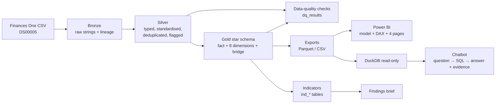

# World Bank procurement analytics: contract awards in Investment Project Financing

End-to-end analytics on the World Bank's public **Contract Awards in Investment Project Financing (since FY2020)**
dataset (Finances One, DS00005, sourced from STEP): a Databricks medallion pipeline with automated data-quality
checks, ten defined procurement indicators, a Power BI model and dashboard specification, a natural-language-to-SQL
assistant with guardrails, and a management brief. Every figure in this repository is produced by code in it.

## Problem

Procurement teams need reliable answers to recurring questions: how much was awarded, through which methods, to
domestic or foreign firms, with how much competition and oversight, and how this is changing. The raw extract (296,826
award lines, 21 columns) cannot be used as-is. It has one row per contract × supplier (joint ventures are split
across rows), inconsistent category labels, placeholder strings (`null`), a Namibia code (`NA`) that most tools
read as missing, multi-valued sector fields, probable duplicate entries and a partial latest fiscal year. This
project turns it into a governed, documented analytical model and makes it queryable by non-technical users.

## Architecture



| Layer | Notebook | Output |
|---|---|---|
| Config | `notebooks/00_config.py` | schema `workspace.wb_procurement`, volumes `raw` and `exports` |
| Bronze | `01_bronze_ingest.py` | `bronze_contract_awards` (all strings, multiline-safe CSV parse, `_source_file`, `_ingested_at`) |
| Silver | `02_silver_transform.py` | `silver_contract_awards`: types, WB fiscal year, region codes, 19 → 18 methods + competition tiers, practice lists, supplier origin, dedup on (contract, supplier), probable-duplicate and outlier flags |
| Gold | `03_gold_model.py` | `fact_contract_awards`, `dim_project`, `bridge_project_practice`, `dim_borrower_country`, `dim_supplier_country`, `dim_supplier`, `dim_procurement_method`, `dim_procurement_category`, `dim_fiscal_year`, `dim_date`, view `vw_awards` |
| Quality | `04_data_quality.py` | `dq_results`: 46 checks (completeness, uniqueness, validity, reconciliation, referential integrity); fails the run on any critical check |
| Indicators | `05_indicators.py` | `ind_summary_by_fy` and 9 more `ind_*` tables |
| Export | `06_export.py` | Parquet + CSV per table in the `exports` volume |
| Orchestration | `99_run_all.py` | runs all stages; schedule it as a Databricks Job |

## Repository

```
notebooks/            Databricks notebooks (source format .py; import or clone as a Git folder)
scripts/              run_pipeline_local.py: runs the same notebooks with local PySpark
profiling/            profile_raw.py → docs/data_profile.md
analysis/             build_findings.py, render_indicator_values.py, render_data_dictionary.py
chatbot/              build_db.py, guardrails.py, llm.py, engine.py, cli.py, app.py (Streamlit)
powerbi/              README.md (model, relationships, page layouts), measures.dax
docs/                 data_profile, indicators, indicator_values, data_dictionary, findings_brief
data/gold/parquet/    gold + indicator exports (so the chatbot runs without Spark)
tests/                guardrail, chatbot and UI tests (pytest)
```

## How to run

### 1. Get the data
Download the CSV from World Bank Finances One, dataset *Contract Awards in Investment Project Financing (since FY
2020)* (DS00005). It is about 115 MB, above GitHub's file limit, so it is not committed.

### 2a. Databricks Free Edition
1. *Workspace → Create → Git folder* with this repository URL (or import the files in `notebooks/`).
2. Open `notebooks/00_config` and run it. It creates the schema and the `raw` volume.
3. *Catalog → workspace → wb_procurement → Volumes → raw → Upload to this volume*: upload the CSV.
4. Run `99_run_all` on serverless compute (the full local test run took about 2.5 minutes).
5. Explore tables in *Catalog*, query `vw_awards` in the SQL editor, or download `exports/`.

### 2b. Locally (tests the same notebooks)
```bash
pip install -r requirements.txt                        # Java 17/21 needed for PySpark
cp ~/Downloads/<file>.csv data/contract_awards_raw.csv
python profiling/profile_raw.py data/contract_awards_raw.csv docs/data_profile.md
python scripts/run_pipeline_local.py                   # bronze → export, writes data/gold/
```

### 3. Chatbot
```bash
python chatbot/build_db.py                             # data/gold/parquet → chatbot/warehouse.duckdb
cd chatbot
python cli.py "What share of FY2025 awards in Africa used open international competition?"
streamlit run app.py                                   # web UI
export ANTHROPIC_API_KEY=...                           # optional: Claude for free-form questions
```
Without an API key the assistant uses a deterministic rule-based planner (fixed vocabulary: years, regions,
countries, categories, methods, domestic/foreign, prior review; intents total/count/share/average/median/top-N).
With a key, Claude writes the SQL from the schema and a business glossary, and writes the answer only from the
returned rows. Either way, every answer shows **the SQL used, the result table, the underlying award lines and the
assumptions** (e.g. "the data has no market-approach field, so open *international* competition cannot be
isolated").

Guardrails (`chatbot/guardrails.py`, tested in `tests/test_chatbot.py`): one statement only; SELECT/WITH only;
any write, DDL, `COPY`, `ATTACH`, `PRAGMA`, `SET`, `INSTALL` is rejected; whitelisted gold tables only; file and
table functions (`read_csv`, `read_parquet`, `glob`, …) are rejected; LIMIT is enforced; the DuckDB connection is
opened `read_only` with external access disabled; 20-second timeout; questions the data cannot answer (bids,
prices, cofinancing, subcontractors) are refused. A Databricks SQL backend is included (`--backend databricks`)
for running against the warehouse; only the DuckDB backend was exercised in this build.

### 4. Power BI
Follow [`powerbi/README.md`](powerbi/README.md): load the exports (or connect to Databricks), create the
relationships, paste [`measures.dax`](powerbi/measures.dax), build the four pages, and reconcile against
[`docs/indicator_values.md`](docs/indicator_values.md).

### 5. Regenerate docs and run tests
```bash
python analysis/build_findings.py && python analysis/render_indicator_values.py && python analysis/render_data_dictionary.py
pytest -q
```

## Key findings (complete fiscal years FY2020–FY2026)

Full brief: [`docs/findings_brief.md`](docs/findings_brief.md). Numbers: [`docs/findings_numbers.json`](docs/findings_numbers.json).

- **Fewer, larger contracts.** Median contract value rose from USD 21,973 (FY2021) to USD 42,000 (FY2026); FY2026 contract count fell 24.8% while value fell 10.4%.
- **The COVID-era spike in direct selection has unwound.** 28.6% of value in FY2021 → 12.4% in FY2026; open-competitive share 81.8% in FY2026, the highest complete year.
- **Value is concentrated.** The largest 1% of contracts carry 54.1% of value; prior review covers 6.2% of contracts but 63.0% of value.
- **Chinese firms lead foreign suppliers.** 41.7% of value won by foreign firms; 22.3% of Works value outside China.
- **Domestic share 60.1%**, from 41.9% (Eastern and Southern Africa) to 77.2% (South Asia).

## Data quality, in brief

From [`docs/data_profile.md`](docs/data_profile.md) and `dq_results`: 296,826 rows; 284,572 contracts; USD
137.56 bn; no exact duplicates and no duplicate (contract, supplier) pairs; 837 probable duplicate entries
(USD 110.7 m) removed from gold; 653 rows without supplier country; 179 without review type; 9 zero amounts;
330 statistical outliers flagged, not removed; fiscal year matches the signing date on every row; all 34 critical
checks pass.

## Limitations

* **Scope of the source**: excludes subcontractor awards and cofinancing; joint-venture contract values are split
  equally across members, so per-supplier amounts are not real work shares.
* **Missing fields**: no market approach (international vs national competition), number of bids, estimated cost
  or evaluation data. Competition intensity and value for money cannot be measured; "open competitive" describes the
  method, not the number of bidders.
* **Timeliness**: FY2027 is partial (to 31 Oct 2026) and recent months may be under-reported because of STEP entry
  lag. The FY2026 drop in contract counts should be re-checked after the next refresh.
* **Identity**: individual consultants are anonymised (one ID per award); company groups can have several Supplier
  IDs, so concentration figures are lower bounds. Supplier country is the registration country.
* **Classification assumptions**: method → competition tier mapping, equal-split allocation of multi-practice
  projects, and `World` treated as international organisations are analyst choices, documented in
  [`docs/indicators.md`](docs/indicators.md) and [`docs/data_dictionary.md`](docs/data_dictionary.md).
* **Testing**: the notebooks were run end to end with PySpark 4.0.1 through `scripts/run_pipeline_local.py`
  (Parquet tables). On Databricks they write Delta tables to Unity Catalog; the Databricks-only calls (`dbutils`,
  volumes, `COMMENT ON TABLE`) sit behind `IS_DATABRICKS` branches and were not executed here.

*Data: World Bank, Finances One (public). This is an independent portfolio project, not a World Bank product.*
