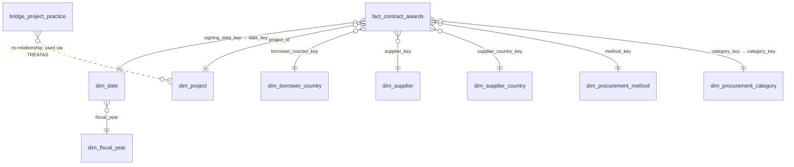

# Power BI: data model, measures and dashboard specification

Build guide for a four-page report on the gold tables. Measures are in [`measures.dax`](measures.dax); the
indicator definitions are in [`../docs/indicators.md`](../docs/indicators.md).

## 1. Get the data

**Option A (simplest): Parquet/CSV exports.** Run `06_export` in Databricks (or `scripts/run_pipeline_local.py`
locally) and download `exports/csv/*.csv` or `exports/parquet/*.parquet`. In Power BI Desktop: *Get data → Parquet*
(or *Text/CSV*) for each table listed below.

**Option B: live connection to Databricks.** *Get data → Azure Databricks* (or *Databricks*), use the SQL
warehouse's *Server hostname* and *HTTP path* (SQL Warehouses → Connection details), authenticate with a personal
access token, then pick `workspace.wb_procurement.<table>`. Import mode is fine at this size (~300k fact rows).

Load these tables: `fact_contract_awards`, `dim_date`, `dim_fiscal_year`, `dim_project`, `dim_borrower_country`,
`dim_supplier`, `dim_supplier_country`, `dim_procurement_method`, `dim_procurement_category`,
`bridge_project_practice`. Optionally load `dq_results` for the appendix page.

In Power Query set types: `amount_usd` = Fixed decimal number; `contract_signing_date`, `date`, `fy_*_date`,
`*_signing_date` = Date; `*_key` codes, `wb_contract_number`, `project_id`, `supplier_key` = Text (important:
`NA` is Namibia, so disable automatic "null" detection if you load CSV); booleans = True/False.

## 2. Star-schema model

| From (many) | To (one) | Cardinality | Cross-filter | Active |
|---|---|---|---|---|
| fact_contract_awards[signing_date_key] | dim_date[date_key] | *:1 | Single | Yes |
| dim_date[fiscal_year] | dim_fiscal_year[fiscal_year] | *:1 | Single | Yes |
| fact_contract_awards[project_id] | dim_project[project_id] | *:1 | Single | Yes |
| fact_contract_awards[borrower_country_key] | dim_borrower_country[borrower_country_key] | *:1 | Single | Yes |
| fact_contract_awards[supplier_key] | dim_supplier[supplier_key] | *:1 | Single | Yes |
| fact_contract_awards[supplier_country_key] | dim_supplier_country[supplier_country_key] | *:1 | Single | Yes |
| fact_contract_awards[method_key] | dim_procurement_method[method_key] | *:1 | Single | Yes |
| fact_contract_awards[category_key] | dim_procurement_category[category_key] | *:1 | Single | Yes |

Design choices:

* **Fiscal year is reached through `dim_date`** (snowflake of one hop). Do not also relate `fact[fiscal_year]` to
  `dim_fiscal_year`; two paths would make the model ambiguous. Hide `fact[fiscal_year]`.
* **`bridge_project_practice` stays disconnected.** A project can list up to several global practices; the measure
  `Allocated Value USD (Practice)` applies each project's `allocation_weight` (1/number of practices) with
  `TREATAS`, so practice totals add up to the overall total without bidirectional filters.
* `dim_borrower_country` holds region attributes (region is a hierarchy level, not a separate table).
* Mark `dim_date` as the date table (`date` column).
* Hide all key columns and the raw fact columns that have a dimension equivalent; expose measures only.
* Sort-by-column: `dim_date[month_name]` by `fiscal_month_number`; `dim_procurement_method[competition_tier]` by
  `tier_sort`; `dim_fiscal_year[fy_label]` by `fiscal_year`.
* Hierarchies: *Geography* = region_name → borrower_country; *Method* = competition_tier → method_group →
  method_name; *Time* = fy_label → fiscal_quarter → month_name.
* Formats: USD measures `$#,0.0,,,"bn"` on cards, `$#,0` in tables; shares as `0.0%`.

## 3. Measures

All measures are in [`measures.dax`](measures.dax), organised in display folders:

| Folder | Measures | Indicator |
|---|---|---|
| 1 Core | Award Value USD, Contracts, Award Lines, Avg Contract Value USD, Median Contract Value USD | I1, I2, I3 |
| 2 Method mix | Method Value Share, Method Count Share, Open Competitive Value Share, Direct Selection Value/Count Share | I4, I5, I6 |
| 3 Suppliers | Domestic / Foreign / International Org Value Share, Unknown Supplier Country Value USD, Firm Value USD, Top 10 Supplier Value Share, Supplier HHI, Supplier Rank | I7, I8 |
| 4 Oversight | Prior Review Value Share, Prior Review Count Share | I9 |
| 5 Region & sector | Region Value Share, Allocated Value USD (Practice), Practice Value Share | I10 |
| 6 Time comparison | Selected FY, Award Value PY / YoY %, Contracts PY / YoY %, Median Contract Value PY, Open Competitive Share PY (pp change), Award Value FYTD Same Period PY | trend support |
| 7 Labels & DQ | Data Through Label, Partial Year Warning, Outlier Lines, Joint Award Contracts | context |

**Validation.** After building, put `dim_fiscal_year[fiscal_year]` in a table with Award Value USD, Contracts,
Median Contract Value USD, Open Competitive Value Share, Direct Selection Value Share, Domestic Supplier Value
Share, Prior Review Value Share and Top 10 Supplier Value Share, and compare with
[`docs/indicator_values.md`](../docs/indicator_values.md). Values should match to the displayed precision
(medians may differ in the last digit if Power BI and Spark interpolate an even-sized middle pair differently).

## 4. Dashboard layout (16:9 canvas, 1280 × 720)

Global elements on every page: title bar (left), `Data Through Label` and `Partial Year Warning` (right, small
text); slicer panel on the left (width ~200 px) with **Fiscal year** (dim_fiscal_year[fy_label], default: latest
complete FY), **Region** (dim_borrower_country[region_name]), **Procurement category**
(dim_procurement_category[category_name]). Sync slicers across pages. Footer text: "Source: World Bank Finances One
DS00005 (STEP). Excludes subcontracts and cofinancing; JV values split equally among members."

Colour rule: one fixed colour per competition tier on every page (Open competitive = dark blue, Limited competitive =
light blue, Individual consultant = grey, Direct = orange, Other = light grey); highlight colour only for the
selected item.

### Page 1: Executive overview
*Question it answers: How much was awarded, how competitively, and to whom?*

| Zone | Visual | Fields |
|---|---|---|
| Top row (8 cards) | Card (new) with reference label | Award Value USD (ref: Award Value YoY %), Contracts (ref: Contracts YoY %), Median Contract Value USD (ref: PY), Open Competitive Value Share (ref: pp change), Direct Selection Value Share, Domestic Supplier Value Share, Prior Review Value Share, Top 10 Supplier Value Share |
| Middle left (60%) | Clustered column | X: dim_fiscal_year[fy_label]; Y: Award Value USD; secondary line: Contracts. Partial FY column in a lighter shade via conditional formatting on is_complete_fy |
| Middle right (40%) | 100% stacked bar | Y: dim_borrower_country[region_name]; X: Award Value USD; Legend: competition_tier |
| Bottom left | Bar | Top 10 dim_supplier_country[supplier_country] by Award Value USD, filtered to supplier_origin = Foreign |
| Bottom right | Smart narrative or text box | 3 bullets from `docs/findings_brief.md` |

### Page 2: Trends
*Question: what is changing year to year, and is the latest year comparable?*

| Zone | Visual | Fields |
|---|---|---|
| Top left | Line | X: fy_label; Y: Median Contract Value USD and Avg Contract Value USD (two lines; log scale off) |
| Top right | Line | X: fy_label; Y: Open Competitive Value Share, Direct Selection Value Share, Domestic Supplier Value Share, Prior Review Value Share |
| Middle | Line (small multiples by fy_label, or one line per FY) | X: dim_date[fiscal_month_number] (Jul = 1); Y: Contracts; Legend: fy_label. Shows whether the latest year is tracking below earlier years month by month (data-lag check) |
| Bottom left | Stacked column | X: fy_label; Y: Award Value USD; Legend: dim_procurement_category[category_name] |
| Bottom right | Matrix | Rows: fy_label; Values: Award Value USD, Award Value YoY %, Contracts, Contracts YoY %, Top 10 Supplier Value Share, Supplier HHI. Conditional formatting: red/green icons on YoY |

### Page 3: Procurement methods
*Question: which methods are used, for what, and where is direct selection concentrated?*

| Zone | Visual | Fields |
|---|---|---|
| Top left | 100% stacked column | X: fy_label; Y: Method Value Share; Legend: competition_tier |
| Top right | 100% stacked column | Same as left with Method Count Share: shows that value and count tell different stories (RFQ dominates count, not value) |
| Middle | Matrix (heatmap) | Rows: competition_tier → method_name (drill); Columns: category_name; Values: Award Value USD, Method Value Share, Contracts. Background colour scale on Method Value Share |
| Bottom left | Scatter | Details: dim_borrower_country[borrower_country]; X: Award Value USD (log); Y: Direct Selection Value Share; Size: Contracts. Constant line at the portfolio average |
| Bottom right | Table | Top 20 direct-selection contracts: wb_contract_number, borrower_country, supplier_name, category_name, contract_description, Award Value USD; visual-level filter is_direct = True |

### Page 4: Regional and sector drill-down
*Question: where does the money go, and who wins it in each place?*

| Zone | Visual | Fields |
|---|---|---|
| Top left | Filled map or Azure map | Location: borrower_country (category = Country); Colour saturation: Award Value USD. Visual-level filter borrower_type = Country (regional groupings cannot be mapped; they appear in the matrix) |
| Top right | Decomposition tree | Analyse: Award Value USD; Explain by: region_name → borrower_country → category_name → competition_tier → supplier_origin |
| Middle left | Matrix with drill-down | Rows: region_name → borrower_country; Values: Award Value USD, Region Value Share, Contracts, Open Competitive Value Share, Domestic Supplier Value Share, Prior Review Value Share |
| Middle right | Bar | Y: bridge_project_practice[global_practice]; X: Allocated Value USD (Practice); tooltip: Practice Value Share |
| Bottom left | 100% stacked bar | Y: region_name; X: Award Value USD; Legend: fact[supplier_origin] |
| Bottom right | Table | Top 15 suppliers: supplier_name, supplier_country, Award Value USD, Contracts, Supplier Rank; filter is_individual_consultant = False |

Add a **drill-through page "Country profile"** (drill-through field: borrower_country) reusing the KPI cards from
page 1, the trend line from page 2 and the top-suppliers table.

### Appendix (optional): Data quality
Table on `dq_results` (status, severity, check_name, records_flagged, pct_flagged, description) with status icons,
plus cards for Outlier Lines, Joint Award Contracts and Unknown Supplier Country Value USD.

## 5. Publishing notes
* Row-level security is not needed (public data).
* Scheduled refresh: point Option B at the Databricks job that runs `99_run_all`; refresh after the job.
* Accessibility: add alt text to every visual, avoid colour-only encodings (use data labels on 100% bars), keep
  text ≥ 10 pt.
